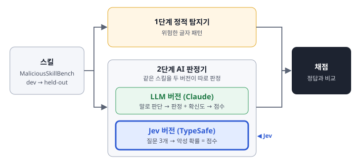

# stage2 — AI 판정기 (담당: 오준서)

SKILL.md의 자연어를 읽고 악성일 가능성을 0~1 점수로 낸다. 두 버전이 있다.

이름: 1단계와 2단계는 같은 SKILL.md를 읽는다. 다른 것은 판단 방법이다. 1단계는 사람이 써 둔 규칙(정규식)으로, 2단계는 AI 모델이 글을 읽고 판단한다. Jev는 LLM이 아닌 판정 전용 모델이라 "LLM 판정기" 대신 "AI 판정기"라고 부른다(2026-10-24, 이전 이름 "설명서 판정기").

| 버전 | 파일 | 어떻게 판단하나 | 점수 |
|---|---|---|---|
| LLM | `llm_judge.py` + `prompt_v2.txt` (기본. v0는 10/24 기준선, v1은 폐기) | LLM이 SAFE / SUSPICIOUS / MALICIOUS와 확신도, 근거 인용을 JSON으로 답한다 | 라벨 구간 + 확신도 (`to_score`) |
| Jev | `jev_judge.py` + `jev_questions_v0.json` | Jev가 정해진 질문 세 개에 확률로 답한다 | `is_malicious` 확률 그대로 |

두 버전은 같은 입력 처리(`common.py`: 읽기, 자르기)를 쓴다.

## 파이프라인과 평가 지표



Jev가 들어가는 지표 (모든 숫자에 데이터 이름·모델·버전을 붙인다):

| 지표 | 무엇을 보나 |
|---|---|
| PR-AUC, FPR 1% 재현율 | 주 성능. LLM 버전과 같은 방식으로 |
| 문턱 0.5 재현율·오탐률 | jev-skillbench와 재현 비교 (1,000개 표본 0.755 / 0.000, 전체 7,907개 0.755 / 0.0008) |
| 네 칸 분해 (정적 × Jev) | 정적 탐지기와 겹치는 범위, Jev만 잡는 범위 |
| LLM–Jev 일치·엇갈림 | 두 판정 방식의 차이, 사례 분석 재료 |
| 건당 비용·시간 | 운영 비교 (1건 약 $0.0001, 1.1초) |
| 3회 반복 흔들림 | 같은 스킬 3번의 점수 차이, 문턱 0.5를 넘나든 수 (LLM 버전도 같이) |

## Jev를 어디에 어떻게 쓰나

**Jev란.** TypeSafe가 만든 판정 전용 AI 모델이다. 글을 생성하지 않고, 정해진 질문(예/아니오, 보기 고르기, 단계 점수)에 확률로 답한다. 내부 구조는 공개되지 않았다. 우리 과제에서는 **2단계 자리에 들어가는 또 다른 판정기**로, LLM 버전과 같은 입력·같은 출력 형식·같은 채점으로 비교된다.

**위치.** Jev는 2단계(AI 판정기)의 두 번째 버전이다. 1단계(정적 탐지기)와는 따로, LLM 버전과는 나란히 돈다. 두 버전은 같은 스킬을 같은 입력 처리(`common.py`)로 받는다.

```
1단계 정적 탐지기 ─────────────────┐
2단계 AI 판정기 ─┬─ LLM 버전 (Claude) ─┼─▶ 채점 → 성적표
                └─ Jev 버전          ─┘
```

**왜 쓰나.**
1. 재현 비교: jev-skillbench가 MalSkillBench에서 낸 Jev 결과를 같은 질문으로 MaliciousSkillBench에서 다시 잰다. 단독, 문턱 0.5 기준으로 1,000개 표본(악성 498, 정상 502)에서 재현율 0.755·오탐률 0.000, 같은 저장소의 전체 7,907개(`jev-1.13.0`)에서 0.755·0.0008이다. 개인 저장소이고 동료 심사는 없다.
2. 성격 비교: 말로 판단하는 LLM과 확률만 내는 판정 전용 모델 중 어느 쪽이 무엇을 잘 잡는가.
3. 사례 분석: LLM 버전과 Jev 버전이 엇갈린 스킬을 들여다본다.

**무엇을 묻나.** `jev_questions_v0.json`의 질문 세 개(jev-skillbench에서 그대로 옮김). 점수는 `is_malicious` 확률, evidence는 `attack_vector`와 `harm_severity` 답.

**언제.**

| 주차 | Jev로 할 일 |
|---|---|
| 1 | 접근 확보 (완료, 2026-10-07) |
| 2 | dev100 전체를 Jev로 3번 판정해 LLM 버전과 비교, 흔들림 기록 |
| 3~4 | dev로 점검. 질문 문장을 바꾸면 재현 비교가 깨지므로 v0 유지가 기본, 바꾸면 v1로 따로 기록 |
| 4 끝 | 동결 |
| 5 | held-out 1회 판정 → 성적표의 "2단계-Jev" 줄, 네 칸 분해, 엇갈린 사례 |

**접근.** Vercel AI Gateway, 모델 `typesafe-ai/jev`, 키는 환경변수 `AI_GATEWAY_API_KEY`(코드나 저장소에 넣지 않는다). 카드 등록과 유료 크레딧이 필요하다(Jev는 무료 등급 모델이 아님). 2026-10-07 오준서가 Vercel AI Gateway 크레딧 $10를 구매해 1건 판정까지 확인했다(영수증 보관, 지원금 청구 예정). 가격 입력 100만 토큰당 $0.042, 출력 무료. 1건 측정값 약 2,400토큰·$0.0001·1.1초라 held-out 1,384건은 약 $0.15로 예상.

**주의.**
- Jev는 내부 구조가 공개되지 않아 왜 그렇게 판정했는지 알 수 없다. 사례 분석의 "이유"는 LLM 버전의 근거와 Jev의 `attack_vector` 답으로 대신한다.
- 입력에 `benchmark_id`, 출처를 넣지 않는다(라벨 누출 방지). Jev 입력 한도 32k 토큰은 공통 자르기 규칙으로 지킨다.
- jev-skillbench의 네 번째 질문(behavior)은 점수에 쓰이지 않아 v0에서 뺐다.
- Jev도 같은 요청에 점수가 조금씩 다르다. jev-skillbench에서 같은 표본을 두 번 돌리니 963개 중 64%만 점수가 같았고, 5~6개는 0.5를 넘나들었다. 그래서 3번 돌린다(아래 "3회 반복").
- `typesafe-ai/jev`는 별칭이라 버전이 바뀔 수 있다. Vercel 경유 응답에는 정확한 버전이 오지 않으므로(details에 `typesafe-ai/jev`로만 남음) 실행 날짜를 함께 기록한다.

## 출력 (팀 공통 형식)

`--out`으로 준 파일에 한 줄에 한 스킬:

```json
{"skill_id": "ASB04_000247", "score": 0.9933, "evidence": ["원문에서 그대로 옮긴 구절"]}
```

같은 이름의 `.details.jsonl`에 판정기만의 정보(모델, 라벨, 확신도, 거부, 파싱 실패, 답 끊김, 자른 글자 수, 토큰, 시간)가 남는다.

## 돌리기

```bash
pip install anthropic           # LLM 버전 (2026-10-24 확인: 2.3.0)
# data/README.md 순서대로 data/dev100 을 먼저 만든다

# LLM 버전, Vercel AI Gateway 경유 (최종 측정용. Jev와 같은 키·크레딧)
export AI_GATEWAY_API_KEY=...
python -m skillsplit.stage2.llm_judge data/dev100 --out runs/stage2_llm_v0_dev100_r1.jsonl

# LLM 버전, Anthropic API 직접 (키가 있을 때. temperature를 보내지 않음, 아래 주의 참고)
export ANTHROPIC_API_KEY=...
python -m skillsplit.stage2.llm_judge data/dev100 --out runs/x.jsonl --backend api

# LLM 버전, 로컬 claude CLI (API 키 없이 코드 점검용. 재현성이 약해 보고서 수치로 쓰지 않음)
python -m skillsplit.stage2.llm_judge data/dev100 --out runs/smoke.jsonl --backend cli --limit 5

# Jev 버전 (Vercel AI Gateway 경유)
export AI_GATEWAY_API_KEY=...
python -m skillsplit.stage2.jev_judge data/dev100 --out runs/stage2_jev_v0_dev100.jsonl --via vercel --limit 1
```

중간에 끊겨도 같은 `--out`으로 다시 돌리면 이미 끝난 스킬은 건너뛴다.

3회 결과를 모아 성능·흔들림·비용·정적과의 네 칸을 보려면(정적 결과 파일은 1단계 `scan`으로 만든다):

```bash
python -m skillsplit.stage2.summarize_runs data/dev100_labels.csv runs/stage1_v0_dev100.jsonl
```

### 3회 반복

temperature 0이어도 답이 완전히 같다는 보장은 없다(Anthropic 문서). 흔들림을 줄일 뿐이다. 그래서 LLM 버전과 Jev 버전 모두 같은 스킬을 3번 판정하고, 결과 파일을 `_r1`, `_r2`, `_r3`으로 따로 쓴다. 보고서에는 세 번의 점수 평균과 함께 흔들림(점수가 모두 같은 비율, 판정이 바뀐 수, 0.5를 넘나든 수)을 적는다.

```bash
for r in 1 2 3; do
  python -m skillsplit.stage2.llm_judge data/dev100 --out runs/stage2_llm_v0_dev100_r$r.jsonl
  python -m skillsplit.stage2.jev_judge data/dev100 --out runs/stage2_jev_v0_dev100_r$r.jsonl --via vercel
done
```

모델과 temperature 주의:
- Anthropic API는 버전 `2026-10-21`부터 모든 모델에서 temperature를 거부하고, Python SDK 1.x부터는 temperature 인자 자체가 없다. (공식 문서: https://platform.claude.com/docs/en/api/versioning , https://platform.claude.com/docs/en/api/migration-2026-10-21 )
- Vercel 경유는 `extra_body`로 넣은 temperature 0을 받아서 실제로 적용한다. Vercel 문서에는 temperature를 받는다는 내용만 있고 실제 적용 여부는 없어, 자체 시험으로 확인했다. 2026-10-24에 같은 질문을 5번 물었더니 0이면 5번 같은 답, 기본값이면 5번 다른 답이었다. 게이트웨이 정책이 바뀔 수 있으니 details의 `date`, `temperature`를 같이 본다.
- 그래서 코드는 Vercel 경유 `anthropic/claude-haiku-4.5`에만 temperature 0을 주고, 다른 경로·모델은 보내지 않는다.
- CLI의 `haiku` 별칭은 2026-10-10 기준 `claude-haiku-5-5`로 연결되므로, CLI 결과는 모델 이름을 details에서 확인한다.

## v0에서 정한 것과 근거

| 항목 | 값 | 근거 |
|---|---|---|
| 자르기 | 12,000자 초과 시 머리 8,000 + 꼬리 4,000 | `docs/research/R2_llm_judge.md` C1, SkillGate 코드 |
| 프롬프트 | SkillGate 시스템 프롬프트를 SKILL.md 단독 입력에 맞게 고침 + 기능-행동 일치 질문 + 결함은 악성 아님 + 근거 인용 | R2 A1, C2, C3 |
| 프롬프트 v2 (2026-10-26, 현재 기본) | v0 + 무관한 강제 실행에 숨김·확인 생략 지시가 붙으면 내용이 안 보여도 MALICIOUS(두 문장을 인용할 수 있을 때만) + 가짜 권위·수정 금지 신호 + `[REDACTED…]`·자르기 표시는 신호 아님 + 근거는 글자 그대로 | dev100 회색 지대 20개 읽기, `docs/stage2-log.md` 10-26. v1은 폐기 |
| 인젝션 방어 | `<<<SKILL_MD_BEGIN>>>` 구분자, 안의 지시 무시, 판정 조작 시도는 악성 신호 | R2 A5, C7 조건 A (Spotlighting delimiting) |
| 모델 | `claude-haiku-4-5`(Vercel 이름 `anthropic/claude-haiku-4.5`), temperature 0 | R2 C4, C5. 경로는 Vercel (2026-10-24, Anthropic 키 없음) |
| 파싱 실패·거부 | 점수 2/3(`FAIL_SCORE`, 문턱 후보 0.5와 2/3 모두에서 걸림), details에 `parse_error`·`refused`로 표시. 답이 512토큰에서 끊긴 경우는 `cut_off`로 따로 표시 | R2 C3, 리뷰(세훈). 2026-10-27 전에는 SUSPICIOUS 0.4 → 점수 0.467이라 문턱 0.5 아래, 즉 안전으로 처리됐음 |
| 근거 검사 | 원문에 없는 인용은 버리고 개수를 기록 | R2 C3 |
| 입력에서 뺀 것 | `benchmark_id`, `source_id`, 스킬 폴더 이름 | 라벨 누출 방지 (R2 C1-5) |
| Jev 질문 | jev-skillbench의 is_malicious, attack_vector, harm_severity | 기존 결과를 다른 데이터에서 재현 |

## 아직 안 한 것

- 프롬프트 v2를 dev100 3회로 기록, 문턱과 실패 점수 결정(실패 0.467이 문턱 아래인 문제), dev 전체 1회(동결 직전)
- 결과 캐시(SQLite, R2 C6), 3회 반복 실행과 흔들림 집계, Spotlighting B 조건 (2주차 이후)
- 점수 문턱 θ와 거부 처리 규칙 확정 (4주차)
